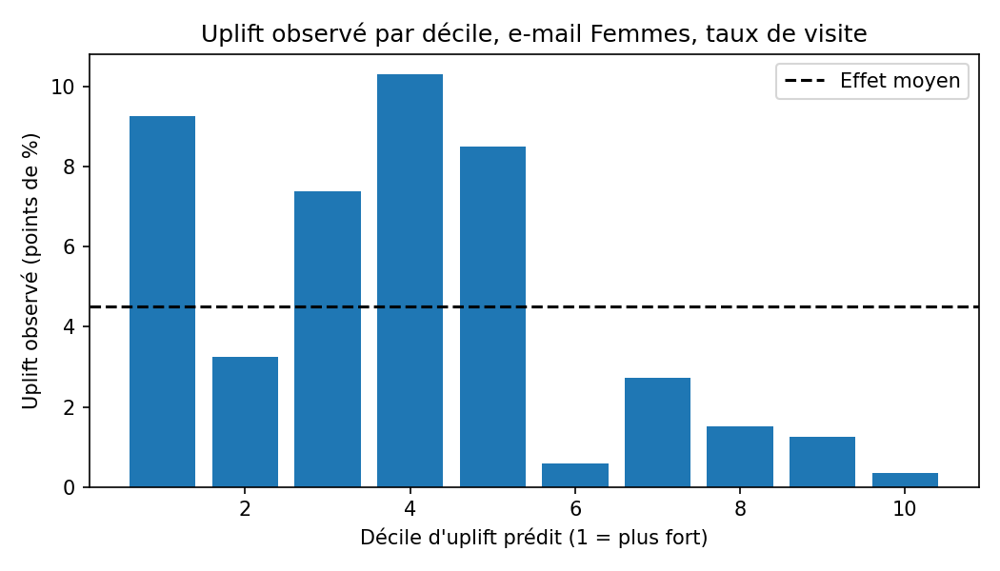
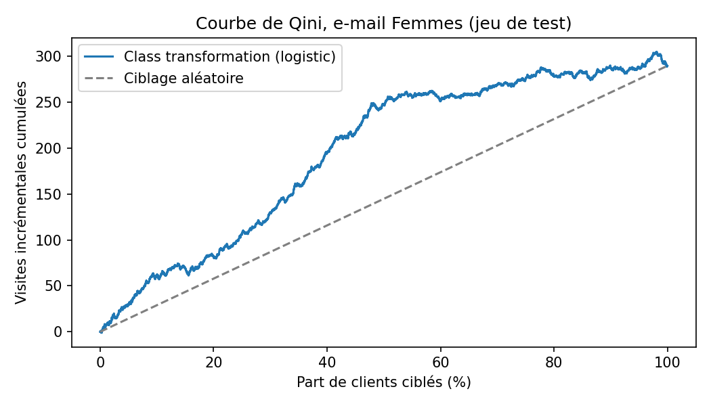
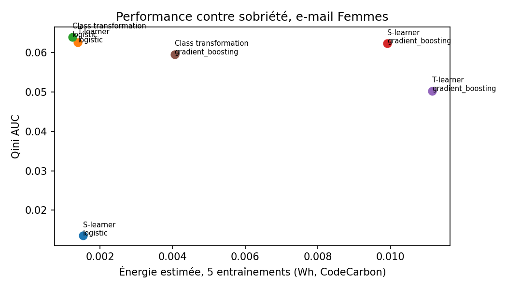

# Ciblage CRM par inférence causale : A/B test, uplift modeling et sobriété

**Question métier :** une campagne e-mail augmente-t-elle vraiment les visites, et à quels clients
faut-il l'envoyer pour obtenir le plus d'effet avec le moins d'envois ?

Répondre « les clients qui ont le plus de chances de visiter » est une erreur classique : beaucoup
auraient visité de toute façon. Ce projet mesure l'**effet causal** de la campagne, puis estime
pour chaque client l'effet *incrémental* de l'envoi (uplift) afin de ne cibler que ceux sur qui
l'e-mail change réellement le comportement.

## Résultats clés

Données : campagne e-mail **randomisée** de 64 000 clients e-commerce (jeu public Hillstrom,
MineThatData), trois bras équilibrés : e-mail Hommes, e-mail Femmes, témoin sans e-mail.

**1. A/B test (effet moyen sur le taux de visite)**

| Variante | Témoin | Traité | Écart absolu (IC 95 %) | Lift relatif | p-value |
|---|---|---|---|---|---|
| E-mail Hommes | 10,6 % | 18,3 % | +7,7 pts (+7,0 ; +8,3) | +72 % | < 0,001 |
| E-mail Femmes | 10,6 % | 15,1 % | +4,5 pts (+3,9 ; +5,2) | +43 % | < 0,001 |

- **Contrôle SRM** (Sample Ratio Mismatch) : p = 0,90, la répartition entre bras est conforme au plan.
- **Puissance** : avec ~21 000 clients par bras, l'effet minimal détectable est de 0,84 pt
  (80 % de puissance, α = 5 %). Les effets observés sont largement au-dessus.
- **CUPED** testé sur la dépense avec la dépense de l'année précédente comme covariable :
  réduction de variance négligeable (< 0,1 %), car cette covariable est très peu corrélée à la
  dépense pendant la campagne. Conclusion utile : CUPED n'aide que si la covariable
  pré-expérience prédit bien la métrique.

**2. Uplift modeling (e-mail Femmes, taux de visite, 5 graines, 30 % en test)**

| Approche | Modèle de base | Qini AUC | Uplift sur le top 30 % | Visites incrémentales captées (top 30 %) | Énergie (Wh, 5 fits) |
|---|---|---|---|---|---|
| Transformation de classe | Logistique | **0,064 ± 0,009** | 7,2 pts | 48 % | 0,0012 |
| T-learner | Logistique | 0,063 ± 0,009 | 6,7 pts | 44 % | 0,0014 |
| S-learner | Gradient boosting | 0,062 ± 0,012 | 7,4 pts | 49 % | 0,0099 |
| Transformation de classe | Gradient boosting | 0,060 ± 0,016 | 7,6 pts | 50 % | 0,0041 |
| T-learner | Gradient boosting | 0,050 ± 0,016 | 6,9 pts | 46 % | 0,0111 |
| S-learner | Logistique | 0,014 ± 0,010 | 5,3 pts | 35 % | 0,0015 |
| Ciblage aléatoire | | 0 | 4,2 pts | 30 % | |

- **Effet métier** : en n'envoyant l'e-mail qu'aux 30 % de clients au plus fort uplift prédit, on
  capte environ **48 % des visites incrémentales** de la campagne avec 70 % d'envois en moins.
  L'uplift observé sur ce groupe (7,2 pts) est **1,7 fois** celui d'un ciblage aléatoire (4,2 pts).
- **Sobriété (Green IT)** : le modèle logistique obtient la meilleure Qini AUC tout en consommant
  **3 à 9 fois moins d'énergie** que les variantes gradient boosting (estimation CodeCarbon). Les
  écarts de performance entre les meilleurs modèles restent dans la marge d'incertitude entre
  graines : le modèle le plus simple est donc le bon choix.
- **Pourquoi l'e-mail Femmes** : son effet est nettement plus hétérogène que celui de l'e-mail
  Hommes (Qini AUC max 0,064 contre 0,025), donc c'est là que le ciblage apporte le plus.
  Près de la moitié des clients réagit à peine à l'envoi (déciles 6 à 10 ci-dessous).





## Démarrage rapide

```bash
python -m venv .venv && source .venv/bin/activate
pip install -r requirements.txt
python -m src.run_all      # régénère results/ et reports/figures/ (moins d'une minute sur CPU)
pytest -q                  # tests des outils statistiques
```

Les chiffres peuvent varier légèrement selon la machine, surtout les mesures d'énergie.

## Méthode et choix

- **Pourquoi l'uplift et pas un modèle de propension** : un modèle de propension classe les clients
  qui vont visiter, y compris ceux qui l'auraient fait sans e-mail. L'uplift estime
  P(visite | e-mail) − P(visite | pas d'e-mail) pour chaque client. Ce n'est possible
  proprement que parce que l'affectation est randomisée.
- **S-learner** : un seul modèle avec le traitement comme variable. Simple, mais peut ignorer le
  traitement si son effet est faible devant les autres variables (d'où son score bas ici en
  logistique).
- **T-learner** : un modèle par groupe, uplift = différence des prédictions.
- **Transformation de classe** : on recode la cible pour qu'un seul classifieur estime directement
  l'uplift (valable avec un traitement assigné à 50/50, ce qui est le cas ici).
- **Évaluation** : Qini AUC et AUUC (qualité du classement par uplift), uplift@30 % et part des
  gains incrémentaux captés. Moyenne et écart-type sur 5 découpages stratifiés
  traitement × résultat, pour ne pas conclure sur un seul tirage.
- **Variables** : uniquement des informations connues avant l'envoi (ancienneté, historique
  d'achat, zone, canal) pour éviter toute fuite d'information.

## Structure

```
src/data.py      chargement, variables pré-traitement, expériences binaires
src/stats.py     SRM, écart de moyennes avec IC, CUPED, effet minimal détectable
src/ab_test.py   analyse de l'A/B test
src/uplift.py    modèles d'uplift, métriques Qini/AUUC, mesure CodeCarbon
src/run_all.py   pipeline complet, résultats et figures
tests/           tests unitaires des outils statistiques
```

## Limites

- Jeu de données public (e-commerce, 2008), utilisé ici comme terrain d'expérimentation : les
  ordres de grandeur ne se transposent pas tels quels à un autre contexte.
- La métrique principale est la visite : la conversion est trop rare (moins de 1 %) pour un
  modèle d'uplift stable sur ce volume.
- Les mesures d'énergie CodeCarbon sont des estimations ; seul l'ordre de grandeur relatif entre
  modèles est interprétable.

## Source des données

Kevin Hillstrom, *MineThatData E-Mail Analytics and Data Mining Challenge* (2008), jeu public.
